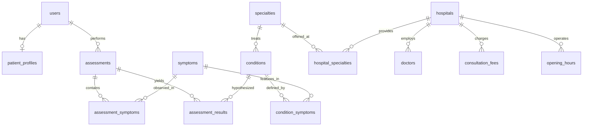

# MediGuide AI – Database Architecture & Schema Documentation

**Database Engine**: SQLite  
**Database File Name**: `SQLITE#.db`  
**Locations**: `backend/database/SQLITE#.db` and `backend/SQLITE#.db`

---

## Entity Relationship Overview

---

## Detailed Table Specifications

### 1. `users`
| Column | Type | Constraints | Description |
| :--- | :--- | :--- | :--- |
| `id` | INTEGER | PRIMARY KEY | Unique user ID |
| `email` | VARCHAR(120) | UNIQUE, NOT NULL | Login email address |
| `password_hash` | VARCHAR(255) | NOT NULL | Werkzeug/bcrypt hashed password |
| `full_name` | VARCHAR(100) | NOT NULL | User's full name |
| `phone` | VARCHAR(20) | NULLABLE | Contact telephone |
| `role` | VARCHAR(20) | DEFAULT 'patient' | 'patient' or 'admin' |
| `created_at` | DATETIME | DEFAULT utcnow | Account creation timestamp |

### 2. `patient_profiles`
| Column | Type | Constraints | Description |
| :--- | :--- | :--- | :--- |
| `id` | INTEGER | PRIMARY KEY | Unique profile ID |
| `user_id` | INTEGER | FK -> users.id, UNIQUE | Associated user |
| `age` | INTEGER | NULLABLE | Patient age |
| `gender` | VARCHAR(20) | NULLABLE | Male/Female/Other |
| `location` | VARCHAR(100) | DEFAULT 'Chennai' | Residential locality |
| `chronic_conditions` | TEXT | NULLABLE | Known pre-existing conditions |
| `allergies` | TEXT | NULLABLE | Known drug allergies |
| `emergency_contact` | VARCHAR(50) | NULLABLE | Emergency telephone |

### 3. `symptoms`
| Column | Type | Constraints | Description |
| :--- | :--- | :--- | :--- |
| `id` | INTEGER | PRIMARY KEY | Unique symptom ID |
| `code` | VARCHAR(50) | UNIQUE, NOT NULL | Alphanumeric identifier (e.g. FEV, HEADACHE) |
| `name` | VARCHAR(100) | NOT NULL | Clinical symptom name |
| `category` | VARCHAR(60) | NOT NULL | Anatomical/clinical category |
| `body_part` | VARCHAR(60) | NULLABLE | Target anatomical region |
| `is_red_flag` | BOOLEAN | DEFAULT FALSE | Emergency red-flag indicator |
| `default_weight` | FLOAT | DEFAULT 1.0 | Clinical relevance weight |
| `synonyms` | TEXT | NULLABLE | Comma-separated patient terminology |

### 4. `conditions`
| Column | Type | Constraints | Description |
| :--- | :--- | :--- | :--- |
| `id` | INTEGER | PRIMARY KEY | Unique condition ID |
| `code` | VARCHAR(50) | UNIQUE, NOT NULL | Code identifier (e.g. COND_TENSION_HA) |
| `name` | VARCHAR(120) | NOT NULL | Condition clinical name |
| `category` | VARCHAR(60) | NOT NULL | Medical classification |
| `urgency_level` | VARCHAR(20) | DEFAULT 'Routine' | Emergency / Urgent / Routine / Self-Care |
| `recommended_specialty_id`| INTEGER | FK -> specialties.id | Target medical specialty |
| `general_explanation` | TEXT | NULLABLE | Patient-friendly clinical summary |
| `when_to_seek_care` | TEXT | NULLABLE | Actionable triage advice |

### 5. `hospitals` (Real Chennai Healthcare Establishments)
| Column | Type | Constraints | Description |
| :--- | :--- | :--- | :--- |
| `id` | INTEGER | PRIMARY KEY | Unique facility ID |
| `name` | VARCHAR(150) | NOT NULL | Official institution name |
| `normalized_name` | VARCHAR(150) | NOT NULL, INDEX | Cleaned token string for deduplication |
| `facility_type` | VARCHAR(30) | DEFAULT 'Hospital' | 'Hospital' or 'Clinic' |
| `address` | VARCHAR(255) | NOT NULL | Street address |
| `locality` | VARCHAR(80) | NOT NULL | Chennai locality (T. Nagar, Adyar, etc.) |
| `latitude` | FLOAT | NOT NULL | WGS84 Latitude coordinate |
| `longitude` | FLOAT | NOT NULL | WGS84 Longitude coordinate |
| `phone` | VARCHAR(100) | NULLABLE | Public verified telephone number |
| `website` | VARCHAR(200) | NULLABLE | Official hospital website |
| `emergency_24x7` | BOOLEAN | DEFAULT TRUE | 24 Hours casualty availability |
| `source_url` | VARCHAR(255) | NULLABLE | Provenance source URL |
| `last_verified` | VARCHAR(50) | NULLABLE | Verification timestamp |

### 6. `consultation_fees` & `opening_hours`
Strictly follows the prompt mandate:
- `fee_status`: Set to `'Published'` if official fee verified (e.g., ₹900); otherwise displays `'Call to confirm'`.
- `opd_timing_note`: Shows verified hours or explicitly `'Schedule not verified – contact hospital'`.
